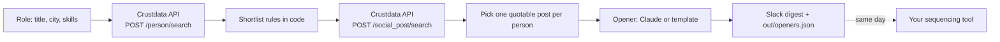

# Outreach Opener Writer (Open Source, Personalized Recruiter Outreach)

**An open-source Python tool that writes the first line of a recruiting message from something the candidate actually posted.**

Nobody replies to "I came across your profile". People answer when the message shows you read what they wrote. Give the tool a role (title, city, optional skills) and it builds the shortlist, pulls each person's recent posts, picks one real thing each person said and drafts an opener around it. [Crustdata](https://crustdata.com) is the people and post data layer ([API docs](https://docs.crustdata.com)). Claude writes the line when you turn it on; a plain template covers the rest.


## How it works



1. **Shortlist.** `POST /person/search` with the current title and city. Skills are optional.
2. **Re-check the shortlist.** Each result must have a profile URL, hold the title on a current role (nested filters can match different roles), and list every required skill.
3. **Pull posts.** `POST /social_post/search` for the shortlist's profile URLs, newest first, inside the window (`SINCE_DAYS`).
4. **Pick one real thing.** A post is quotable when it is inside the window, is not a plain repost (no words of their own) and has at least 12 real words once links, hashtags and mentions are stripped. Originals beat quote-reposts, then the newest wins.
5. **Write the line.** Claude (`--claude`) writes one or two sentences around the quote; without it, a template does. If Claude declines or is not configured, the template is used.
6. **Hand off.** New drafts only (`.state/seen.json`), Slack digest plus `out/openers.json`. Load the file into whatever sequencing tool you send from.

## Quickstart

Requires Python 3.9+. No dependencies for the core tool.

```bash
git clone https://github.com/mhimed-crustdata/outreach-opener-writer
cd outreach-opener-writer
make setup        # creates .env, then add your CRUSTDATA_API_KEY
make demo         # never posts to Slack
make run          # posts new drafts to SLACK_WEBHOOK_URL
make test         # unit tests, no network
```

Other roles and cities: `python3 opener.py --title "Data Engineer" --city Berlin --skills "Python,SQL" --claude`.
Pick titles as Crustdata stores them (the `person_autocomplete` endpoint lists the exact values).

## Configuration

| Variable | Default | What it does |
|---|---|---|
| `CRUSTDATA_API_KEY` | required | Your Crustdata API key. Read from the environment only |
| `ROLE_TITLE` | `Product Designer` | Current title to source |
| `ROLE_CITY` | `London` | City of the profile |
| `ROLE_SKILLS` | empty | Comma-separated skills every candidate must list |
| `SINCE_DAYS` | `180` | How far back to read posts. The indexed post data is rebuilt periodically, so very short windows can come back empty |
| `SLACK_WEBHOOK_URL` | empty | Slack incoming webhook. Empty means no Slack post |
| `ANTHROPIC_API_KEY` | empty | Optional Claude step |
| `ANTHROPIC_MODEL` | `claude-opus-5-5` | Model for the optional Claude step |

Flags: `--shortlist-size` (default 50), `--max-posts`, `--claude`, `--dry-run`, `--all` (ignore saved state).
Output files in `out/` contain personal data and are git-ignored.

## Example output

A real run on 2026-10-27 against the live API: Product Designers in London, a 180-day window, a shortlist of 50 (the search matched 1,082). Individuals are not shown. Aggregated:

```json
{
  "shortlist": 50,
  "posts_in_window_for_shortlist": 55,
  "posts_read_newest_first": 40,
  "post_types_read": {"original": 22, "quote_repost": 14, "plain_repost": 4},
  "people_with_any_post": 6,
  "people_with_a_quotable_post": 4
}
```

Most designers do not post in public. Only 6 of the 50 had any post in six months and 4 had one worth quoting, which is why the tool skips people without one instead of faking a hook. Of the 40 posts read, 26 were from July; the newest were from August.

What the Slack digest looks like (redacted):

```text
:writing_hand: 4 openers drafted for Product Designer
• *[Name]* ([YYYY-MM-DD]): [One or two sentences built on one thing they wrote]
  [link to the post]
```

## How to build a personalized outreach agent

1. **Start from the shortlist, not the message.** Title, skills and city decide who gets a message at all.
2. **Use real posts as the source of the hook.** Pull recent posts with the documented `POST /social_post/search` call, filtered to the shortlist's profile URLs.
3. **Write the rules in code, not in a prompt.** Window, plain reposts, minimum text, one post per person. Re-check nested matches on the same record.
4. **Skip people with nothing to quote.** A generic line is the thing you are replacing.
5. **Use the model for the words, not the list.** Give Claude one quote and tight rules (no flattery, no profile talk) and keep a template fallback.
6. **Only draft what is new.** Save state so a post is never used twice, then send from your sequencing tool the same day.

## FAQ

**How to personalize recruiter outreach?**
Open with one specific thing the candidate wrote, not their profile. This tool pulls each shortlisted person's recent posts from Crustdata, picks one quotable post and drafts the first line around it.

**Why does it skip some candidates?**
Many people have not posted in the window, or only reposted others. The rules in `usable_post` reject those, and each rule has a unit test.

**Does it contact anyone?**
No. It only posts to your own Slack webhook when `SLACK_WEBHOOK_URL` is set and `--dry-run` is off. Sending the message is up to you.

**Is Claude required?**
No. It is optional and off unless `ANTHROPIC_API_KEY` is set and you pass `--claude`.

**Which Crustdata endpoints does it use?**
`POST /person/search` and `POST /social_post/search` on API version `2025-11-01`. See the [Crustdata API docs](https://docs.crustdata.com).

## Project layout

```text
opener.py           # the workflow
crustdata_api.py    # tiny Crustdata client (stdlib only)
notify.py           # optional Slack + Claude
tests/              # unit tests, no network
```

## License

MIT. See [LICENSE](LICENSE). Data layer: [Crustdata](https://crustdata.com) ([docs](https://docs.crustdata.com)).
